# Retrograde — Academic Performance Portal

Retrograde is a demonstration academic performance portal built with **FastAPI**, a **Tailwind CSS** interface and **AWS infrastructure managed by Terraform**. Candidates can sign in with demonstration accounts, view weighted module results and explore the project interface.

The cloud deployment demonstrates HTTPS delivery through CloudFront, load balancing, instance health recovery, private static-asset storage, GitHub Actions deployment and centralized application logging. Its next scaling objective is to accommodate **up to 41 concurrent active candidates**, with **a maximum of four application instances** under the policy described below.

> **Deployment status:** application log delivery was verified on 5 November 2026, and the project owner reports that the remaining deployment tests passed. The AWS console screenshots captured on 5 November 2026 confirm one healthy instance, ASG minimum/desired capacity of 1 and maximum of 2. The alarm list shows no actions, and the shown SNS topic has no subscriptions; alarm notification delivery is not configured through that path. The four-instance scaling policy in this README is a proposed configuration, not a claim that it has already been deployed or tested.
>
> **Use synthetic data only.** This is an educational portal. The reviewed backend uses demonstration identity checks and in-memory sessions; its grades endpoint needs session authorization before use with private student records.

- **Repository:** [MaxwellMensah/retrograde](https://github.com/MaxwellMensah/retrograde)
- **Latest demonstrated URL:** [Open Retrograde](https://d26dnowt2i27ho.cloudfront.net/)
- **Region:** `us-east-1`
- **Team coordination:** Trello; completed by the project team

The environment may be destroyed between demonstrations to control costs. Recreating CloudFront generates a new hostname; always obtain the current URL from Terraform outputs.

## Contents

1. [Problem and objectives](#problem-and-objectives)
2. [Application features](#application-features)
3. [Architecture](#architecture)
4. [AWS services and responsibilities](#aws-services-and-responsibilities)
5. [Scaling for up to 41 candidates](#scaling-for-up-to-41-candidates)
6. [Repository guide](#repository-guide)
7. [Prerequisites and configuration](#prerequisites-and-configuration)
8. [Local development](#local-development)
9. [Deploying the AWS environment](#deploying-the-aws-environment)
10. [GitHub Actions and application releases](#github-actions-and-application-releases)
11. [Application lifecycle and API](#application-lifecycle-and-api)
12. [Monitoring and log delivery](#monitoring-and-log-delivery)
13. [Verification and evidence](#verification-and-evidence)
14. [Security and known limitations](#security-and-known-limitations)
15. [Troubleshooting](#troubleshooting)
16. [Costs and cleanup](#costs-and-cleanup)
17. [Presentation and project handover](#presentation-and-project-handover)
18. [Future improvements](#future-improvements)
19. [References and license](#references-and-license)

## Problem and objectives

The project addresses a common startup scenario: slow page delivery, inconsistent availability during busy periods, security concerns and a deployment process that is difficult to reproduce across a team.

Retrograde demonstrates how to:

- Deliver the application through an HTTPS CloudFront endpoint.
- Route dynamic requests to healthy EC2 targets through an Application Load Balancer.
- Serve images and CSS from a private S3 origin through CloudFront.
- Rebuild infrastructure and replacement instances from version-controlled configuration.
- Validate and release changes through GitHub Actions and peer-reviewed pull requests.
- Observe application behavior through metrics, alarms and centralized logs.
- Keep the demonstration's capacity and costs bounded.

This project demonstrates self-healing infrastructure. One desired application instance is not uninterrupted high availability: instance failure or replacement can interrupt requests. Multiple healthy instances across Availability Zones and durable shared state are needed for a stronger availability design.

## Application features

| Feature | Description |
|---|---|
| Candidate results | Weighted scores, module breakdown, grades and GPA presentation |
| Interface | Responsive landing page, sign-in, results, and About & Contact views |
| Capacity display | Backend status polling displays active sessions and instance/capacity information |
| Thinkibot | Interface assistant for project, sign-in, grading and capacity questions |
| Session tracking | Heartbeats, explicit logout and expiry support active-login metrics |
| Cloud delivery | CloudFront, ALB, EC2, nginx and private S3 assets |
| Repeatable releases | Terraform infrastructure and GitHub Actions deployment scripts |
| Observability | Application/nginx log streams, CPU alarm and target 5xx percentage alarm |

### Curriculum weights

| Module | Weight |
|---|---:|
| AWS Cloud Services | 25% |
| Terraform IaC | 20% |
| Linux Administration | 15% |
| Networking & Security | 15% |
| Database Essentials | 15% |
| AI Fundamentals | 10% |
| **Total** | **100%** |

Demonstration accounts and results must match the records in `app.py`. The intended test audience is up to 41 active candidates; verify that enough distinct synthetic accounts exist before testing that load.

## Architecture

**Target capacity: minimum 1, initial desired 1, maximum 4 instances.** The diagram documents the intended four-instance design ahead of the next Terraform apply. The last verified deployment and the retained screenshots show a maximum of **2**; they are historical evidence, not confirmation that the four-instance update is live.

Setting the maximum to 4 permits four instances but does not launch four immediately or implement the 13/26/39-login policy by itself. Apply and verify both the capacity limit and the scaling policy described below.

### Request flow

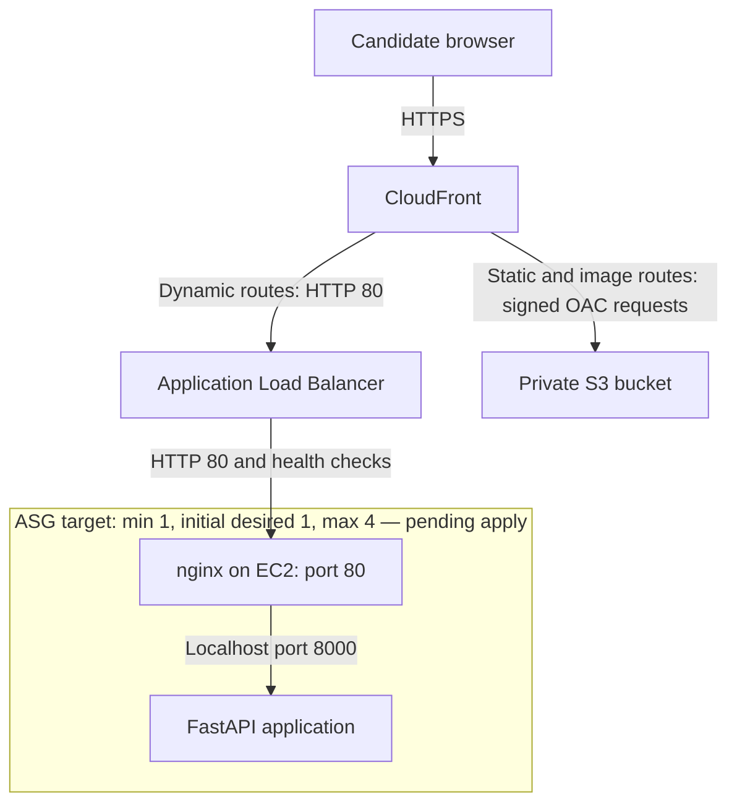

The EC2 box represents the application stack repeated across up to four instances in the intended design, starting with one instance. CloudFront sends `/static/*` and `/images/*` to S3; its default behavior forwards application traffic to the ALB.

| Connection or control | Deployed behavior in the reviewed configuration |
|---|---|
| Browser → CloudFront | HTTPS; HTTP viewer requests redirect to HTTPS |
| CloudFront → ALB | HTTP on port 80 |
| ALB → EC2 | HTTP on port 80; nginx forwards to FastAPI |
| nginx → FastAPI | `127.0.0.1:8000` |
| Health check | `/health`, expecting HTTP 200 |
| ALB ingress | CloudFront origin-facing managed prefix list on port 80 |
| EC2 application ingress | ALB security group on port 80 |
| Static origin | Private S3 with Origin Access Control and a distribution-scoped bucket policy |
| Dynamic caching | Disabled |
| Static caching | Reviewed default TTL 60 seconds; maximum 300 seconds |
| Session routing | ALB cookie stickiness, reviewed duration 3,600 seconds |

**TLS terminates at CloudFront in this configuration.** HTTPS at the public URL does not mean CloudFront-to-ALB or ALB-to-EC2 traffic is encrypted. The instructor accepted the default CloudFront hostname, which uses CloudFront's default certificate; a custom domain is not required for this demonstration.

### Monitoring and scaling flow

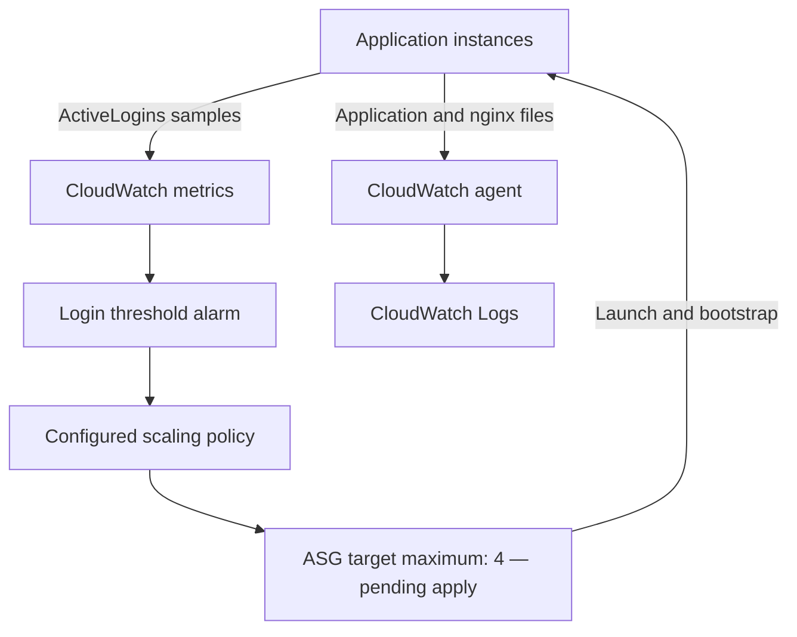

Login-based scaling requires its alarm and policy to be enabled. The ALB distributes requests; the ASG changes instance capacity when its configured policy or health checks require it.

## AWS services and responsibilities

| Service | Responsibility |
|---|---|
| Existing VPC and selected subnets | Network placement across the configured Availability Zones; Terraform looks these up rather than creating a complete new network |
| CloudFront | HTTPS entry point, HTTP viewer redirects, dynamic routing and static caching |
| S3 | Private static assets and application bootstrap artifacts |
| Application Load Balancer | Target selection, sticky sessions and health checks |
| EC2 / launch template | Amazon Linux 2023 hosts, nginx, FastAPI and bootstrap configuration |
| Auto Scaling Group | Desired capacity, replacement of unhealthy instances and optional dynamic scaling |
| IAM | Instance permissions, deployment permissions and GitHub OIDC trust |
| Systems Manager | Administrative access where the instance is registered and reachable |
| CloudWatch | Metrics, alarms and centralized application/nginx logs |
| AWS Budgets | Cost notifications at the configured threshold |
| GitHub Actions | Validation and application deployment workflow |

## Scaling for up to 41 candidates

### What “every 13 logins” means

For this project, the intended policy is to **start adding capacity when the 13th, 26th and 39th concurrent active candidates arrive**. This is an early scale-out policy, giving headroom before an instance would need to serve another full group of 13 users.

| Concurrent active candidates | Intended capacity after scale-out settles |
|---|---:|
| 0–12 | 1 instance |
| 13–25 | 2 instances |
| 26–38 | 3 instances |
| 39–41 | 4 instances |

The requested capacity is:

`min(4, 1 + floor(active_candidates / 13))`

With scale-in disabled, this is an upward capacity target: after reaching four instances, falling traffic does not automatically reduce the group to the lower table row.

A different interpretation—“allow 13 users per instance before adding another”—would use `ceil(active_candidates / 13)`, with a minimum of one. Its expansion points would be **14, 27 and 40**. Both interpretations reach four instances for 41 users. This README uses **13, 26 and 39** to match the intended trigger wording.

These thresholds are a demonstration policy, **not a measured EC2 capacity limit**. Login count alone does not establish how many requests an instance can handle. Load tests should also measure latency, errors and CPU.

### Four-instance target and deployment baseline

| Item | Last reviewed configuration | Intended four-instance design |
|---|---|---|
| Minimum / initial desired capacity | 1 / 1 | 1 / 1 |
| Maximum capacity | 2 | 4 |
| Login scaling | Optional; absent from the last shared plan | Explicitly enabled and tested |
| Scaling action in source | Simple scaling: add 1 when total logins exceed the threshold | Capacity bands corresponding to 13, 26 and 39 active candidates |
| Automatic scale-in | Not configured | Keep disabled while sessions remain in memory |

**Increasing `max_size` to 4 alone does not implement the table.** The reviewed `ChangeInCapacity = 1` policy responds to one global threshold. If that alarm remains breached, further scale-outs can occur after cooldown; it does not wait for the next group of 13 candidates.

An implementation option is a scale-out **step scaling policy with `ExactCapacity`** targets of 2, 3 and 4 for the corresponding login bands. The alarm threshold, inclusive/exclusive step bounds, warmup and policy settings must be implemented together and tested. Step bounds are relative to the alarm threshold in the API/Terraform configuration. Do not simply copy the table numbers into step bounds without calculating those offsets.

Capacity control must also prevent lower bands from reducing an already larger group while sessions remain in memory. Do not assume an `ExactCapacity` target by itself guarantees scale-out-only behavior; verify that the implemented policy only raises desired capacity, or use capacity-aware control that enforces this restriction.

No four-instance Terraform policy is introduced by this README. Update the infrastructure code and review its plan before describing these bands as deployed behavior.

### How active logins are measured

1. A successful sign-in creates an in-memory session on the serving instance.
2. Browser heartbeats refresh activity; explicit logout removes the session.
3. Sessions without a heartbeat expire after the configured TTL, default 600 seconds.
4. Each instance publishes `ActiveLogins` once per minute to the ASG-wide metric series.
5. A 60-second `Sum` across samples in that series represents the fleet count when each instance publishes exactly one sample for that minute.
6. The alarm evaluates that metric and invokes its scaling policy when configured conditions are met.

Use `Namespace = Retrograde/Portal` with the `AutoScalingGroupName` dimension for the fleet metric. Do not add the separately published per-instance series to it again. Longer sum periods, duplicate publishers or retries that duplicate samples can overcount. Missing instance samples can undercount.

The reviewed deployment runs one Uvicorn worker per instance. Changing worker/process counts needs coordinated shared session storage and metric publishing; otherwise each process can have separate state and publish duplicate or incomplete counts.

### Timing, routing and session limits

Scaling is not instantaneous. Publication interval, alarm evaluation periods, cooldown/warmup, instance bootstrapping and ALB health checks all contribute to the delay. The reviewed optional alarm uses two 60-second evaluation periods and the simple policy uses a 300-second cooldown.

Existing sticky sessions generally remain on their original instance. Adding a server does not migrate those sessions or guarantee an even split of active candidates. New clients can use the added capacity. A browser tab closing is not guaranteed to send logout; the heartbeat expiry handles abandoned sessions.

Candidate deduplication is local to each instance, not a fleet-wide guarantee. Shared session storage is needed for reliable global uniqueness and safe automatic scale-in. Instance replacement or restart can lose the current in-memory sessions.

### Boundary tests for the proposed policy

Test **12 → 13**, **25 → 26**, **38 → 39**, and **41** active candidates after implementing the policy. Maintain distinct candidates and heartbeats, then capture the metric, alarm, scaling activity, desired capacity and healthy target count. Confirm repeated evaluation at a fixed count does not keep adding beyond its intended band.

Also test a direct jump to 41 users, the four-instance maximum, missing metric samples and traffic falling after scale-out. Do not claim automatic scale-in unless a separate safe policy has been implemented and tested.

## Repository guide

| Path | Purpose |
|---|---|
| `.github/workflows/` | Python/Terraform validation and deployment automation |
| `app.py` | FastAPI routes, demonstration data, session tracking and metrics |
| `requirements.txt` | Python dependencies |
| `templates/index.html` | Application interface |
| `static/css/styles.css` | Styles served through the static origin in AWS |
| `images/` | Application images and, when added, presentation evidence |
| `scripts/deploy.sh` | Deployment orchestration |
| `scripts/deploy-remote.sh` | Remote application update, artifact synchronization and health checks |
| `terraform/main.tf` | Main resources, log group, metric alarms and optional scaling resources |
| `terraform/github-deploy.tf` | GitHub OIDC and deployment access configuration |
| `terraform/bootstrap.sh.tftpl` | Instance setup template |
| `terraform/install-logging.sh` | Agent configuration and application log capture |
| `terraform/monitoring.tf` | Scoped log-delivery IAM policy and monitoring outputs |
| `terraform/variables.tf` | Terraform inputs |
| `terraform/outputs.tf` | Resource names and endpoint outputs |
| `monitoring-fix/verify-delivery.sh` | Fresh application-event delivery test, if retained from the monitoring patch |
| `simulate_logins.py` | Application traffic/session simulator |
| `docs/` | Project guides where present in the checkout |
| `AWS_SETUP.md` | Additional environment setup instructions |

Keep local state, saved plans, credentials, private keys, `.terraform/`, virtual environments and backups out of Git. Ignore the monitoring patch's `*.before-monitoring` backups too. Retain `.terraform.lock.hcl` in version control. Use a sanitized example variable file for team onboarding; never publish secrets in `terraform.tfvars`.

## Prerequisites and configuration

Required tools: Git, Python compatible with the application dependencies, Terraform compatible with the repository constraints, AWS CLI, and an authenticated AWS identity with appropriate deployment permissions. The instance bootstrap uses Python 3.11 on Amazon Linux 2023. Node/npm is needed only when rebuilding Tailwind assets with the repository's configured build process.

The Terraform configuration expects an existing VPC and matching subnets. Check its lookup filters before deployment. Configure your own account/region values, notification email and budget; do not assume another team's network names exist in your account.

```bash
git clone https://github.com/MaxwellMensah/retrograde.git
cd retrograde
aws sts get-caller-identity
```

Use the correct AWS profile for the intended account. If using named profiles, set `AWS_PROFILE` to your configured profile name before AWS/Terraform commands.

### Important settings

| Setting | Meaning |
|---|---|
| `aws_region` | Deployment region; demonstrated in `us-east-1` |
| `name_prefix` | Project resource naming prefix |
| Instance type | Latest shared plan uses `t3.small` |
| `enable_login_scaling` | Enables the optional login alarm and policy where defined |
| `scale_threshold` | Reviewed optional policy's login threshold; not a complete capacity-band policy |
| ASG `min_size`, initial `desired_capacity`, `max_size` | Target values: **1, 1, 4**. Set in the ASG resource or through variables exposed by the current checkout; last verified deployed maximum was 2 |
| `budget_limit_amount` | Monthly alert budget; latest shared plan showed USD 2 |
| `budget_alert_email` | Destination for budget notifications |
| `acm_certificate_arn` | Optional custom-domain certificate; empty for the demonstrated CloudFront default hostname |

Application environment:

| Variable | Reviewed default / purpose |
|---|---|
| `SCALE_THRESHOLD` | `12`; application status threshold, which should agree with the selected scaling design |
| `SESSION_TTL_SECONDS` | `600`; inactive-session expiry |
| `CW_PUBLISH` | Set to `false` locally; enabled for deployed metric publishing |
| `CW_NAMESPACE` | `Retrograde/Portal` |
| `ASG_NAME` | Actual group name discovered/configured at bootstrap |
| `AWS_REGION` / `AWS_DEFAULT_REGION` | SDK/CLI deployment region |

## Local development

From the repository root:

```bash
python3 -m venv .venv
source .venv/bin/activate
python -m pip install -r requirements.txt
CW_PUBLISH=false python -m uvicorn app:app --reload --port 8000
```

Open `http://localhost:8000`. If Uvicorn is not included in the current dependency list, install it in the virtual environment and add it to the project's dependency specification.

Use synthetic demo accounts defined in the current `app.py`. The earlier account list included `student1` through `student40` with `studentN@retrograde-demo.com`; verify the list before use and provide an additional distinct synthetic account for a 41-candidate test if needed.

Check simulator arguments with `python simulate_logins.py --help`. Where supported:

```bash
python simulate_logins.py --url http://localhost:8000 --users 13
```

A local run with `CW_PUBLISH=false` tests application behavior; it does not test AWS scale-out. A cloud scaling test must use the deployed endpoint, publish metrics, preserve per-user cookies and maintain active heartbeats.

## Deploying the AWS environment

Run these commands from the repository root:

```bash
terraform -chdir=terraform init
terraform -chdir=terraform fmt -check
terraform -chdir=terraform validate
terraform -chdir=terraform plan -out=deployment.tfplan
terraform -chdir=terraform apply deployment.tfplan
terraform -chdir=terraform output
```

Review the plan before applying. After an intentional destroy, a full create plan is expected. For an existing deployment, an unexpected full create plan may indicate the wrong backend/workspace or missing state; resolve that before proceeding.

A Git branch is not a separate AWS environment. Preserve state between runs and use the intended backend/workspace. Saved plan files and state may contain sensitive values; do not commit them.

Bootstrap downloads application artifacts, prepares the Python environment, configures nginx/systemd, and installs the CloudWatch agent. Wait for healthy ALB targets and CloudFront deployment before testing the URL.

To obtain the current hostname:

```bash
terraform -chdir=terraform output -raw cloudfront_domain_name
```

The monitoring-enabled template configures new instances automatically. Existing instances that have not been refreshed need the logging installer run separately after its IAM policy and log group exist. Installing logging restarts the application.

## GitHub Actions and application releases

The project uses GitHub for version control and Actions for validation/deployment. The deployment workflow was reported working after resolving OIDC trust and SSH configuration problems.

Release workflow:

1. Make changes on a feature branch and open a pull request.
2. Run Python checks and Terraform format/validation checks.
3. Have a teammate review the change.
4. Merge to `main` and follow the configured deployment workflow.
5. Confirm remote health checks succeed and the application shows the new release.

GitHub obtains AWS access through the configured OIDC trust relationship. SSH-based deployment uses the repository's configured credentials and host verification. Keep private keys and tokens in GitHub secrets; never commit them or disable host verification to bypass a mismatch.

The reviewed remote script pulls `main`, installs dependencies, synchronizes static/application artifacts to S3 and restarts the application. It preserves the separate logging drop-in. After an environment rebuild, update deployment values derived from Terraform outputs and the current instance/host key.

**Multiple-instance release requirement:** updating one EC2 host does not update every running ASG instance. Before using four instances, ensure releases reach all healthy hosts or use a controlled launch-template/instance-refresh strategy. Synchronizing S3 helps replacement instances boot with current code but does not update already running processes.

Infrastructure application is a separate operation unless the current workflow explicitly runs `terraform apply`. A passing validation job alone does not deploy infrastructure or prove application health.

## Application lifecycle and API

1. CloudFront serves the interface and cached static assets.
2. A candidate submits the demonstration identity fields.
3. FastAPI creates a tracked session and returns its identifiers.
4. The interface requests the candidate's grade breakdown.
5. Heartbeats refresh activity, and the interface polls capacity information.
6. Explicit logout or TTL expiry removes active-session state.
7. Metrics and logs support monitoring and optional scaling.

| Method | Endpoint | Purpose |
|---|---|---|
| GET | `/` | Application interface |
| POST | `/api/login` | Demonstration sign-in and session creation |
| POST | `/api/session/heartbeat` | Refresh tracked session activity |
| POST | `/api/session/logout` | Remove tracked session |
| GET | `/api/grades/{student_id}` | Demonstration grade data; reviewed implementation needs authorization enforcement |
| GET | `/api/traffic-status` | Activity and instance/capacity information |
| GET | `/health` | Application/target-group health check |

## Monitoring and log delivery

| Signal | Configuration |
|---|---|
| EC2 CPU | Average CPU above 80% for two 300-second periods in the reviewed alarm |
| Target 5xx percentage | Above 5% for one 60-second period |
| Application metrics | `ActiveLogins` and `LoginEvents` under `Retrograde/Portal` |
| Log group | `/aws/ec2/retrograde-app` |
| Log retention | Seven days |
| Streams per instance | `INSTANCE_ID/application`, `INSTANCE_ID/nginx-access`, `INSTANCE_ID/nginx-error` |

The corrected error-rate expression is:

```text
IF(requests > 0, 100 * FILL(errors, 0) / requests, 0)
```

`errors` is `HTTPCode_Target_5XX_Count` and `requests` is `RequestCount`, both `Sum` over 60 seconds with matching `LoadBalancer` dimensions. Six errors in 100 requests is 6% and breaches; five in 100 is exactly 5% and does not breach; six in 200 is 3% and does not breach.

This monitors **target-generated** errors. ALB-generated errors use separate metrics and are not included. A low-traffic sample can breach with a single error; choose evaluation windows appropriate to the demonstration.

An alarm being `OK` is not proof of a tested alarm transition or email delivery. Notification delivery requires configured actions and confirmed subscriptions. The supplied console screenshots confirm both alarms show **No actions**. The shown `Default_CloudWatch_Alarms_Topic` has **0 subscriptions**. Creating that topic alone does not configure alarm notifications. Attach the intended topic to each alarm, create and confirm an appropriate subscription, and test delivery before marking notifications complete. Keep those changes in Terraform so they survive a rebuild.

### Verifying fresh log delivery

From the repository root with an authenticated AWS CLI identity permitted to read logs:

```bash
CLOUDFRONT_DOMAIN=$(terraform -chdir=terraform output -raw cloudfront_domain_name)
bash monitoring-fix/verify-delivery.sh \
  us-east-1 \
  '/aws/ec2/retrograde-app' \
  "https://$CLOUDFRONT_DOMAIN"
```

Adjust the region/group if you changed the configuration. The verification script requests a unique nonexistent route and searches the **application** log stream for its marker. HTTP 404 is expected. A `PASS` proves a fresh request event arrived in CloudWatch, not merely that the group exists. Repeat per instance or inspect each instance's fresh stream when testing a larger fleet.

## Verification and evidence

The following evidence was captured on **5 November 2026**. Each caption distinguishes a visible configuration or observed result from behavior that the screenshot does not test.

| Check | Evidence | Conclusion |
|---|---|---|
| Application log delivery | Verification script returns PASS and identifies an application stream | Fresh test request reached CloudWatch for the displayed instance |
| Retention | Log-group details show `1 week` | Seven-day retention confirmed |
| Target 5xx alarm | Percentage label and threshold above 5 for one datapoint in one minute | Deployed percentage threshold confirmed; the graph does not display the underlying expression |
| CPU alarm | Above 80 for two datapoints within ten minutes | Deployed CPU condition confirmed |
| Alarm notifications | Both alarms show `No actions`; SNS topic shows zero subscriptions | Notification configuration remains incomplete for this path |
| Target health | One target is healthy on HTTP port 80 | One healthy application target confirmed at capture time |
| ASG capacity | Minimum 1, desired 1, maximum 2, one healthy instance | Current capacity confirmed; four-instance policy remains proposed |
| S3 artifacts | `app/`, `images/`, `static/` prefixes visible | Artifact layout confirmed; this is not proof of OAC restrictions or public-access denial |
| Landing page | Application hero renders | Visual interface confirmed; screenshot alone does not test redirects or the full candidate journey |
| CI/CD and Trello | Previously reported complete/working by the team | Add the successful Actions run and completed-board evidence for submission |

### Landing page

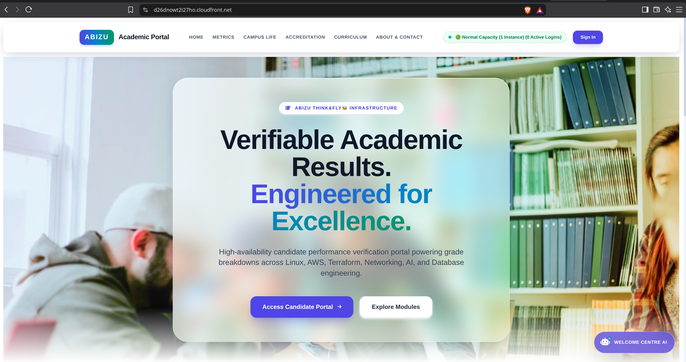

The deployed interface displays the academic portal hero. The marketing text in the screenshot is not evidence of uninterrupted high availability; the captured ASG is running one instance.

### Fresh application log delivery

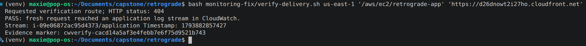

The verification script deliberately requests a nonexistent URL, so **HTTP 404 is expected**. Its PASS result identifies a fresh marker in the application stream. This proves log delivery for that instance; it is not an alarm-trigger test.

### Seven-day retention

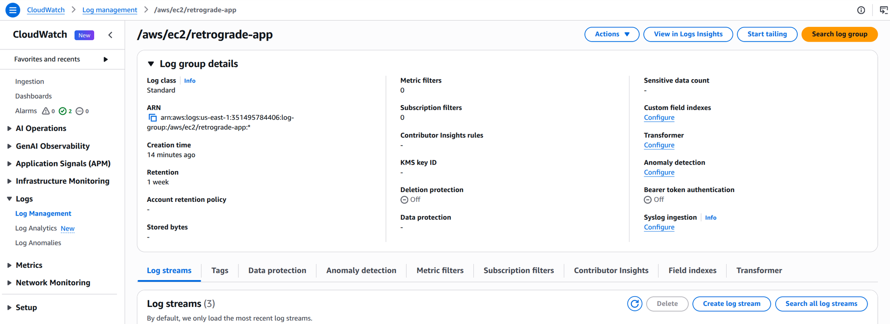

`/aws/ec2/retrograde-app` shows retention of **1 week** and three log streams. Stream existence alone is insufficient to prove delivery; the separate marker test above supplies that evidence.

### Deployed alarms

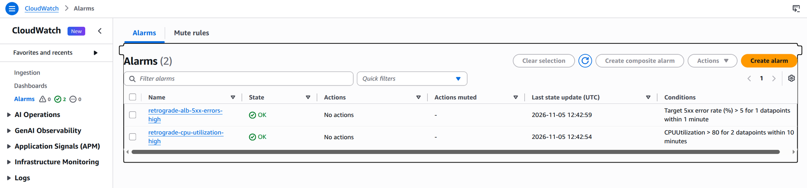

Both alarms are **OK** at capture time. The list confirms the target 5xx and CPU conditions and shows **No actions** for both. It does not demonstrate an ALARM transition or notification delivery.

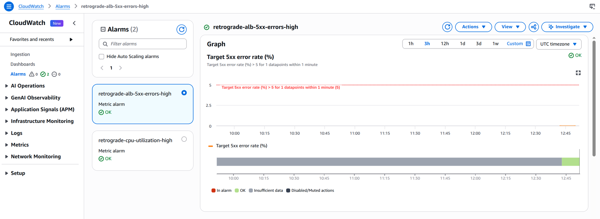

The target error alarm is labeled as a percentage and configured above **5% for one datapoint within one minute**. The implementation uses `100 × target 5xx / requests > 5%`, with zero/missing-data handling as shown in the monitoring section. Capture the metric-math expression view if expression-level console evidence is required; it is not visible in this graph.

### Healthy target and ASG capacity

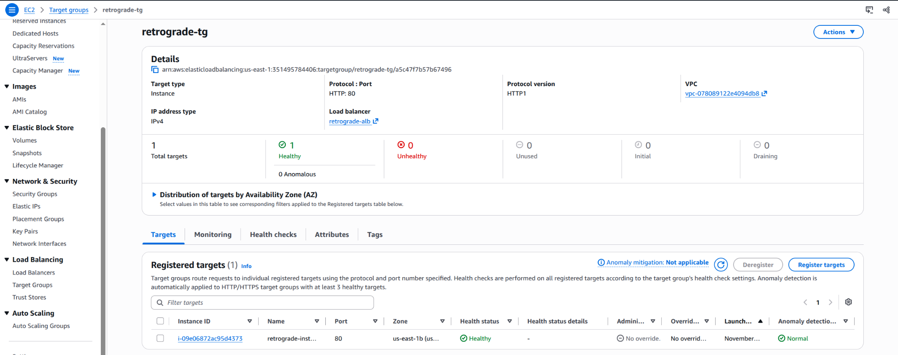

The target group shows **1 healthy target**, **0 unhealthy targets**, and **HTTP:80**. This is health evidence at one point in time, not proof of failover or replacement behavior.

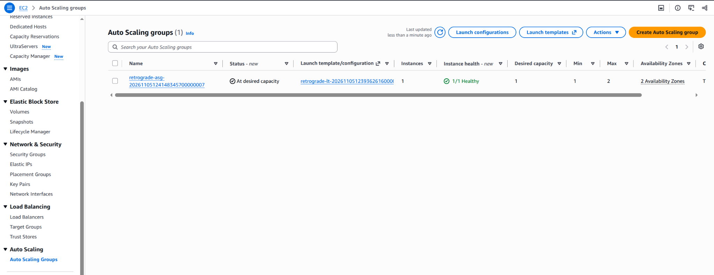

The ASG shows minimum **1**, desired **1**, maximum **2**, and **1/1 healthy**. Two Availability Zones are configured, but only one application instance is running. The proposed 13/26/39-login capacity bands still require a policy change and boundary tests.

### S3 artifact layout

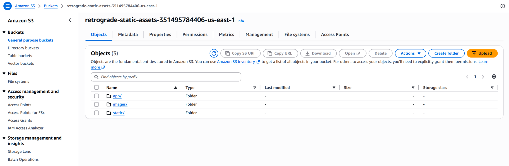

The bucket contains `app/`, `images/` and `static/`. To prove private asset delivery separately, retain OAC/bucket-policy evidence and results showing CloudFront asset success with direct anonymous S3 access denied.

### Notification configuration still to complete

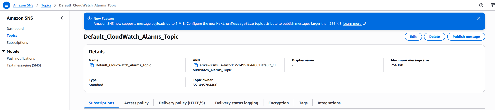

The topic exists, but **Subscriptions (0)** is visible. Combined with the alarm list's **No actions**, these screenshots do not support a claim that alarm emails are working. A successful SNS test message proves the subscription path; an alarm-triggered notification test additionally proves the alarm-to-topic connection. Document the test method rather than treating either as proof of a real CPU/5xx breach.

### Remaining evidence for the final handover

- Successful GitHub Actions deployment run and post-deployment health result.
- Completed Trello board screenshot.
- HTTP-to-HTTPS redirect response and static asset response evidence.
- Any tested replacement/scaling activity, with the exact capacity configuration used.
- Proposed four-instance policy boundary tests after implementation.
- Alarm action/subscription configuration and notification receipt after setup.

All embedded images use the supplied filenames under `images/evidence/`; copy that directory together with this README into the repository. The earlier repository listing showed `docs/`; these AWS screenshots do not establish the current repository directory layout. Keep the repository-guide entry aligned with the actual checkout rather than introducing a new `documentation/` directory solely for the README.

## Security and known limitations

- **Demonstration authentication:** matching a username/email pair is not strong identity verification. The reviewed grades route looks up a student ID without validating the requesting session. Add server-side authentication and authorization before handling private records.
- **Volatile sessions:** in-memory tracking is lost on restart or replacement and is not shared across instances. Sticky sessions reduce routing changes but do not provide durable state.
- **HTTPS scope:** browser-to-CloudFront is encrypted; reviewed origin connections use HTTP. Add origin TLS when implementing end-to-end encryption.
- **Origin restrictions:** EC2 application ingress is limited to the ALB security group. ALB ingress uses CloudFront's managed origin-facing prefix list. That list covers CloudFront generally; it does not identify only this distribution. A distribution-specific origin secret/header check is an additional hardening option.
- **Private static storage:** S3 public access is blocked and asset access is granted through OAC for this distribution. Direct public S3 requests should fail while CloudFront asset URLs succeed.
- **Administrative access:** SSM is available where configured. The reviewed release scripts also use SSH; describe and audit any workflow-managed SSH rule rather than claiming exclusive SSM access.
- **IAM scope:** runtime and deployment permissions have different needs. Reviewed deployment code writes artifacts to S3, so the full instance permission set should not be described as read-only.
- **Logging:** never log credentials, private keys or sensitive grade/session data. Seven-day retention limits storage duration; local application log rotation uses copytruncate, which has a small possible loss window during rotation.
- **Availability:** an ASG with one desired instance provides recovery capability, not a guarantee of uninterrupted service.

## Troubleshooting

| Symptom | Checks |
|---|---|
| Unhealthy ALB targets | `/health`, nginx status, FastAPI on localhost:8000, security-group source/port, target registration and bootstrap completion |
| No application logs | Agent status, `/var/log/retrograde/application.log`, log-write IAM permissions, correct group/region and outbound CloudWatch Logs connectivity |
| No login metrics | `CW_PUBLISH`, ASG name, namespace, `cloudwatch:PutMetricData`, heartbeat activity and publisher logs |
| No scale-out | Policy enabled, correct metric dimensions, alarm evaluation, ASG maximum, warmup/cooldown and scaling activity failure messages |
| More scale-outs than expected | A global `+1` alarm is not the proposed capacity-band policy; inspect repeated alarm actions and current desired capacity |
| New instance has old code | S3 bootstrap artifacts, release synchronization and launch-template version |
| Different versions across instances | Single-host release scripts versus whole-ASG deployment strategy |
| Static asset 403 | OAC, bucket policy distribution ARN, object key and CloudFront behavior |
| Static asset stale | Asset caching TTL, versioned filenames or an intentional invalidation |
| Redirect failure | CloudFront viewer protocol policy and the actual requested hostname; do not open extra EC2 ports as a workaround |
| GitHub authentication/SSH failure | OIDC trust subject/audience, key format, current host and verified host key |
| Full create plan for an existing deployment | Correct account, directory, workspace/backend and state file |

On EC2:

```bash
sudo systemctl status retrograde nginx amazon-cloudwatch-agent --no-pager
sudo tail -n 50 /var/log/retrograde/application.log
sudo tail -n 50 /var/log/retrograde-bootstrap.log
sudo tail -n 50 /opt/aws/amazon-cloudwatch-agent/logs/amazon-cloudwatch-agent.log
curl -fsS http://127.0.0.1:8000/health
curl -fsS http://127.0.0.1/health
```

Application stdout/stderr now goes to the application log file. `journalctl -u retrograde` remains useful for service lifecycle failures but no longer contains all application output.

## Costs and cleanup

This is a budget-conscious demonstration, not a guarantee of zero charges. Instance count, instance size, load balancing, distributions, traffic, storage, logs and custom metrics affect costs. Four instances can increase compute usage substantially compared with one; scale-in is not automatic in the reviewed session design.

The latest shared plan specified a **USD 2 monthly budget** with an alert above **80% of actual spend**. Adjust `budget_limit_amount` if the intended budget is USD 1. Budget notifications do not cap or stop expenditure.

After saving necessary evidence and data, remove the environment from the repository root:

```bash
terraform -chdir=terraform plan -destroy
terraform -chdir=terraform destroy
```

S3 is configured with `force_destroy = false`; unmanaged objects can prevent bucket deletion. Inspect and back up anything needed before removing remaining objects. Do not delete Terraform state as a substitute for destroying resources. Keep state available until cleanup completes and check for resources created outside this configuration.

The VPC/subnets looked up as data sources are not owned by this deployment and are not removed by its destroy operation. CloudFront removal can take time. Logs managed by the configuration may also be removed; export required evidence before teardown.

## Presentation and project handover

The showcase follows the required presentation topics:

1. Explain the customer problem and the academic portal's role.
2. Walk through CloudFront → ALB → EC2 and the private S3 asset route.
3. Explain the security boundaries and known limitations accurately.
4. Demonstrate a GitHub Actions deployment and visible application change.
5. Show the completed Trello board and team task history.
6. Open the current HTTPS endpoint and demonstrate a candidate journey.
7. Discuss Git/OIDC/SSH/deployment blockers and their resolutions.
8. Explain lessons learned and future improvements.

Handover includes source code, setup instructions, architecture diagram, completed Trello evidence, current demo URL, presentation slides and test evidence. A recorded demonstration is optional. Before presenting, replace screenshots and URLs from earlier destroyed deployments and check that the landing page is reachable.

## Future improvements

1. Implement and test the proposed four-instance scaling bands.
2. Enforce authenticated, authorized access to candidate records.
3. Move sessions and global active-user counts into shared storage.
4. Make deployment consistent across every active instance.
5. Introduce controlled scale-in with session draining and suitable cooldowns.
6. Add origin TLS, distribution-specific origin controls and appropriate abuse protection.
7. Attach alarm notification actions, confirm SNS subscriptions and test receipt; add separate ALB-generated error monitoring.
8. Measure performance under the 41-candidate workload before making capacity claims.
9. Use a protected shared Terraform backend and documented recovery process for team collaboration.

## References and license

- [EC2 Auto Scaling step and simple policies](https://docs.aws.amazon.com/autoscaling/ec2/userguide/as-scaling-simple-step.html)
- [Target tracking metric requirements](https://docs.aws.amazon.com/autoscaling/ec2/userguide/as-scaling-target-tracking.html)
- [Application Load Balancer metrics](https://docs.aws.amazon.com/elasticloadbalancing/latest/application/load-balancer-cloudwatch-metrics.html)
- [CloudWatch agent configuration](https://docs.aws.amazon.com/AmazonCloudWatch/latest/monitoring/CloudWatch-Agent-Configuration-File-Details.html)
- [CloudFront distribution settings and certificates](https://docs.aws.amazon.com/AmazonCloudFront/latest/DeveloperGuide/DownloadDistValuesGeneral.html)

Distributed under the MIT License, as stated in the project's `LICENSE` file.