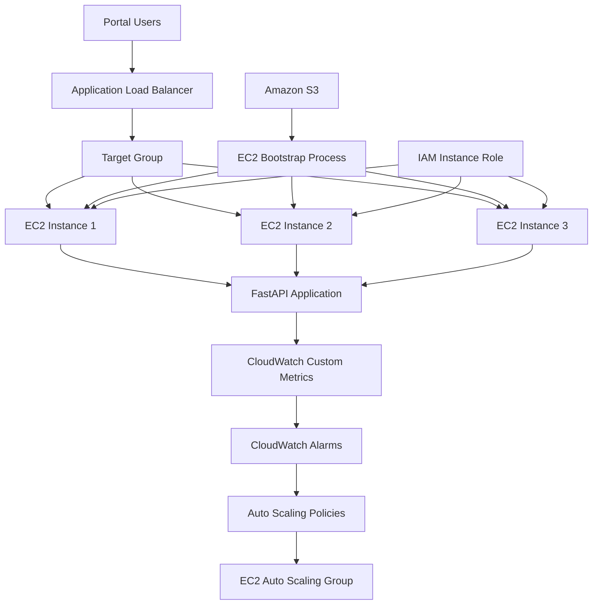

# Project Retrograde – System Architecture

## 1. Introduction

Project Retrograde uses a cloud-based architecture designed to host an academic performance portal while automatically adjusting computing capacity based on user activity.

The architecture combines application hosting, load balancing, storage, monitoring, identity management, and automated scaling through Amazon Web Services (AWS).

The main objective is to ensure that the application can handle changing user traffic without requiring administrators to manually launch or terminate EC2 instances.

## 2. Architecture Overview

The system consists of the following major components:

1. Users accessing the academic portal.
2. An Application Load Balancer (ALB) receiving incoming HTTP requests.
3. An EC2 Auto Scaling Group hosting the application.
4. Amazon S3 storing application deployment files.
5. Amazon CloudWatch collecting application metrics and monitoring activity.
6. AWS IAM controlling permissions granted to application instances.
7. Terraform defining and provisioning the infrastructure.

## 3. High-Level Architecture Diagram



*Note: The diagram illustrates the intended architecture and possible instance expansion. The actual number of running instances depends on the Auto Scaling Group configuration and scaling activity.*

## 4. Component Description

### 4.1 Application Users

Users access the academic performance portal through a web browser.

They interact with the application to perform activities such as:

- Accessing the portal homepage.
- Logging into the system.
- Maintaining active sessions.
- Accessing academic grade information.
- Checking application traffic status.

User requests enter the AWS environment through the Application Load Balancer.

### 4.2 Application Load Balancer (ALB)

The Application Load Balancer acts as the entry point for incoming application traffic.

Its responsibilities include:

- Receiving HTTP requests from users.
- Forwarding requests to registered application instances.
- Distributing requests across healthy targets.
- Performing health checks to determine whether application instances are available.

In the current Terraform configuration:

- The listener uses port 80.
- Incoming traffic is forwarded to a target group.
- The target group communicates with application instances on port 8000.

The ALB helps prevent all incoming requests from being directed to a single EC2 instance.

### 4.3 Amazon EC2

Amazon Elastic Compute Cloud (EC2) provides the virtual servers used to host the application.

Each EC2 instance runs the Project Retrograde FastAPI application.

The reviewed Terraform configuration uses:

- Amazon Linux 2023.
- An x86-64 architecture.
- A default instance type of `t3.micro`.
- Instance Metadata Service Version 2 (IMDSv2).

EC2 instances provide the computing resources required to process application requests.

### 4.4 EC2 Auto Scaling Group

The Auto Scaling Group manages the number of EC2 instances running the application.

Rather than requiring an administrator to manually add or remove servers, the group can adjust its capacity based on configured scaling policies.

The reviewed configuration includes:

| Setting | Default value |
|---|---:|
| Minimum instances | 1 |
| Maximum instances | 3 |
| Default instance type | t3.micro |

When application activity reaches the configured scale-out condition, the Auto Scaling Group can increase the number of instances.

When activity remains below the configured scale-in condition, it can reduce the number of instances, provided the scaling policy is enabled and its conditions are satisfied.

### 4.5 Amazon S3

Amazon Simple Storage Service (S3) provides object storage for the application's deployment files.

The project uses S3 as a location from which newly launched EC2 instances can retrieve application files during initialization.

The intended process is:

1. Application files are uploaded to an S3 bucket.
2. A new EC2 instance starts.
3. Its bootstrap script executes.
4. The script retrieves the required files from S3.
5. Python dependencies are installed.
6. The FastAPI application is started.

This approach allows newly launched instances to obtain the application files they need without requiring manual file transfers.

### 4.6 Amazon CloudWatch

Amazon CloudWatch monitors application activity through custom metrics.

The reviewed application uses the following metrics:

- `ActiveLogins`
- `LoginEvents`

The metrics are published under the namespace:

`Retrograde/Portal`

CloudWatch receives the metrics and evaluates configured alarms.

The ActiveLogins metric is used by the scaling configuration to determine whether application activity has crossed the configured thresholds.

### 4.7 AWS IAM

Identity and Access Management (IAM) controls what AWS resources the EC2 instances can access.

The project uses an IAM role and instance profile to provide permissions to application instances.

The reviewed permissions support operations such as:

- Retrieving application objects from S3.
- Publishing custom metrics to CloudWatch.
- Describing Auto Scaling Groups.
- Using AWS Systems Manager through its managed policy.

Using an instance role avoids placing permanent AWS access keys directly inside the application code.

Permissions should remain limited to the resources and operations required by the application.

### 4.8 Terraform

Terraform is used to define and provision the AWS infrastructure.

Instead of manually creating every resource through the AWS Management Console, Terraform allows the team to describe the infrastructure in configuration files.

The project's Terraform directory contains:

- `main.tf`
- `variables.tf`
- `outputs.tf`
- `user_data.sh.tpl`

These files define infrastructure resources, configurable parameters, deployment outputs, and EC2 initialization instructions.

## 5. How the Architecture Works

The system operates through the following sequence.

### Step 1: User Access

A user opens the academic performance portal through the Application Load Balancer's DNS address.

The ALB receives the incoming HTTP request.

### Step 2: Request Distribution

The ALB forwards the request to the target group.

The target group directs the request to a healthy EC2 instance running the FastAPI application.

### Step 3: Application Processing

The FastAPI application processes the request.

Depending on the requested operation, the application may:

- Authenticate a demonstration user.
- Create or update session information.
- Refresh an active session.
- Process a logout request.
- Return academic grade information.
- Return traffic information.

### Step 4: Activity Monitoring

The application tracks login and session activity.

Relevant activity information is published to CloudWatch through custom metrics.

### Step 5: CloudWatch Evaluation

CloudWatch evaluates the configured metrics against the alarm thresholds.

The reviewed configuration includes:

- Scale-out when ActiveLogins exceeds 12 for one 60-second evaluation period.
- Optional scale-in when ActiveLogins falls below 8 for five consecutive 60-second evaluation periods.

### Step 6: Auto Scaling

When an alarm activates, its associated scaling policy can instruct the Auto Scaling Group to adjust the desired number of EC2 instances.

For example, the group may increase its capacity from one instance to two or three instances, subject to its configured limits and the scaling policy.

### Step 7: Continued Availability

The newly launched instances execute their bootstrap process, retrieve the application files from S3, and start the application.

After successful health checks, they can become available as targets behind the load balancer.

## 6. Network Architecture

The project uses security groups to control communication between the load balancer and application instances.

The intended traffic arrangement is:

| Source | Destination | Port | Purpose |
|---|---|---:|---|
| Internet/allowed CIDR | ALB | 80 | Incoming HTTP requests |
| ALB security group | EC2 security group | 8000 | Application communication |
| EC2 instances | Required AWS services | HTTPS/API | AWS service communication |

The application instances are not intended to accept direct public traffic on port 8000.

Instead, application requests should pass through the load balancer.

**Security consideration:** The reviewed configuration does not include an HTTPS listener. HTTPS should be implemented before the application is used with real credentials or sensitive academic information.

## 7. Monitoring and Scaling Configuration

The project uses application-level activity to influence scaling decisions.

The general process is:

```text
User Login
    |
    v
Application Tracks Activity
    |
    v
CloudWatch Receives Metrics
    |
    v
CloudWatch Evaluates Alarm
    |
    v
Scaling Policy Is Triggered
    |
    v
Auto Scaling Group Adjusts Capacity
```

This design demonstrates how application-level metrics can be used alongside AWS infrastructure services to manage computing resources.

However, the actual effectiveness of the scaling configuration must be demonstrated through CloudWatch alarm history and Auto Scaling activity records.

## 8. Architectural Limitations

The current architecture has several limitations that should be considered.

### 8.1 HTTP Instead of HTTPS

The reviewed configuration exposes an HTTP listener on port 80.

Without HTTPS, information transmitted between users and the application may not be adequately protected in transit.

### 8.2 In-Memory Session Storage

The application currently stores session information in process memory.

This means that different EC2 instances do not automatically share the same session information.

A shared session store would be more appropriate for a multi-instance application.

### 8.3 In-Memory Sample Records

The current demonstration uses sample student records rather than a production-grade persistent academic database.

A database would be required for reliable long-term storage and retrieval of academic records.

### 8.4 Limited Scaling Capacity

The reviewed configuration sets the maximum number of instances to three.

This limits how much additional computing capacity can be introduced during periods of high activity.

### 8.5 Authentication and Authorization

The grades endpoint requires further authorization review to ensure that users cannot access academic records belonging to other students.

These limitations should be addressed before the system is considered suitable for production use.

## 9. Conclusion

The Project Retrograde architecture demonstrates the integration of a web application with AWS cloud infrastructure.

By combining FastAPI, EC2, an Application Load Balancer, an Auto Scaling Group, Amazon S3, CloudWatch, IAM, and Terraform, the project provides a foundation for demonstrating automated infrastructure scaling based on application activity.

The architecture also provides practical learning opportunities in cloud deployment, infrastructure automation, monitoring, access management, and security.

Further improvements to session management, authentication, HTTPS, data persistence, and deployment consistency will strengthen the system and make it more suitable for real-world use.
